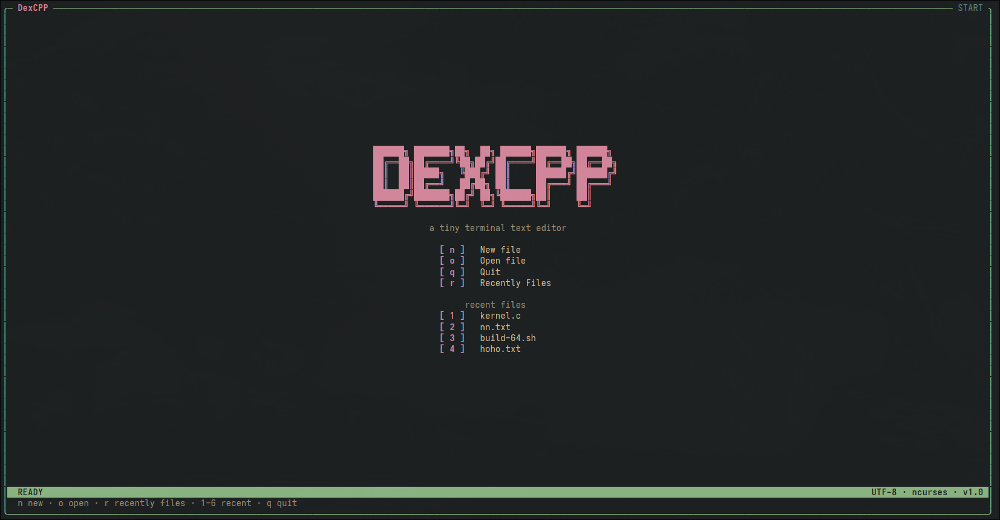
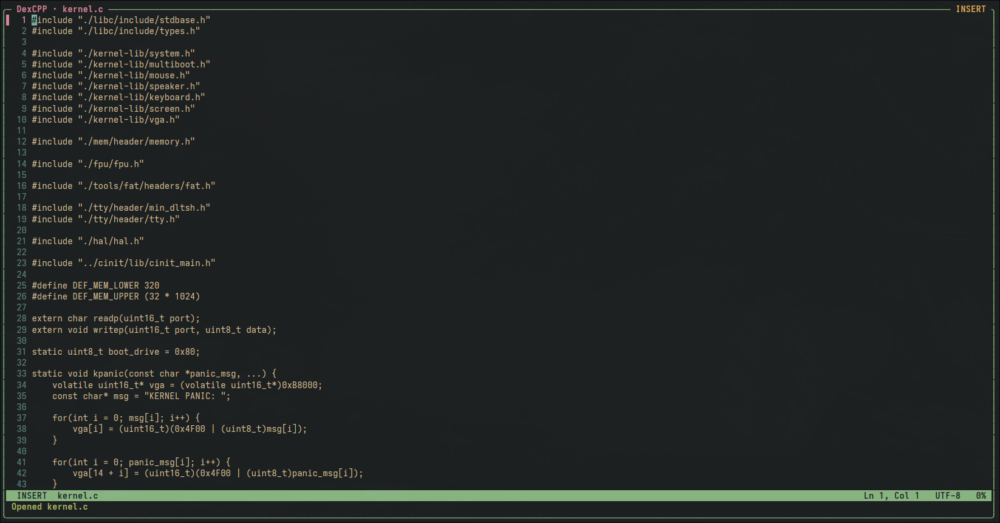
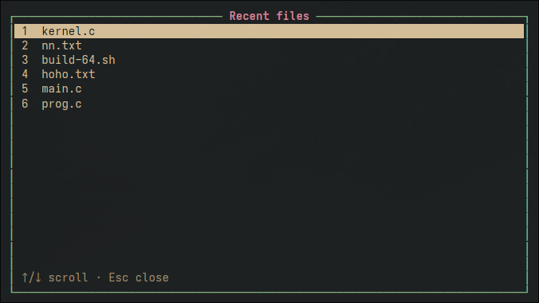

# dexcpp
### Минималистичный текстовый редактор на C++ и ncurses.
### Это некое совмещение простоты редактора Micro и модальности из Vim.
### Комбинации клавиш такие же как например в обычном блокноте, vscode, kate и другие GUI редакторах.

--------------------------------------------------------

### На что способен он сейчас (скриншоты):





-------------------------------------------------------

# Сборка и запуск. 
### Зависимости: cmake, clang/clang++, ncurses.
### Ставьте их сами под свой пакетный менеджер, под apt, rpm, dnf, pacman, xbps, portage и так далее.
### Клонируем репозиторий: `git clone https://github.com/viadev0081/dexcpp`
### Переходим в папку проекта и начинаем сборку:
``` bash
cmake -S . -B build -DCMAKE_CXX_COMPILER=clang++
cmake --build build
```

### Запускаем бинарь: 
``` bash 
./build/DexCPP
```

--------------------------------------------------------

# Ссылки 

### (ТГ Канал разраба)[https://t.me/open_delta_project]
